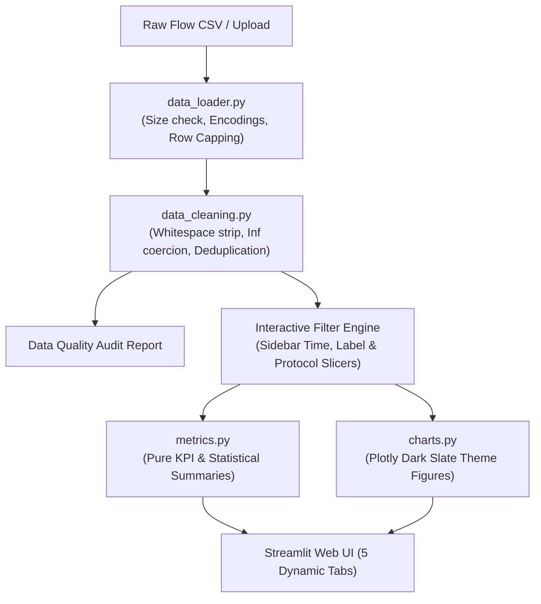

# Academic Project Report Notes
## Subject: Big Data Analysis & Visualization
### Project 1: Cybersecurity Threat Intelligence — Network Traffic Analysis

---

## 1. Problem Statement & Motivation
Modern distributed networks generate immense volumes of bidirectional flow data containing both routine corporate communications and malicious intrusions (e.g., Denial of Service, brute force attacks, automated reconnaissance bots). Traditional manual log inspection is unfeasible at scale. Analysts require systematic big data pipelines capable of:
1. Ingesting diverse network telemetry formats without data loss or crashes.
2. Cleaning, sanitizing non-finite rates, and normalizing inconsistent schema headers.
3. Quantifying attack distributions against known baseline traffic.
4. Surfacing multidimensional flow patterns across time, protocol, port, and statistical attributes.

---

## 2. Project Objectives
- Build a resilient, modular Python analytics and visualization architecture using Streamlit and Plotly.
- Implement robust data ingestion handling UTF-8, Latin-1, and Windows-1252 character encodings.
- Develop transparent data cleaning pipelines that sanitize infinite rates (`np.inf`), resolve missingness, and track duplicates.
- Deliver an intuitive 5-tab user interface enabling interactive filtering across time intervals, protocols, and threat classes.
- Ensure automated verification through a dedicated Pytest test suite covering statistical edge cases.

---

## 3. Dataset Description & Benchmark Citation
- **Primary Benchmark:** Canadian Institute for Cybersecurity — **CIC-IDS2017** Dataset.
- **Institution:** University of New Brunswick (UNB), Canada.
- **Reference Citation:**
  > Iman Sharafaldin, Arash Habibi Lashkari, and Ali A. Ghorbani, *"Toward Generating a New Intrusion Detection Dataset and Intrusion Traffic Characterization"*, Proceedings of the 4th International Conference on Information Systems Security and Privacy (ICISSP), pp. 108–116, 2018.
- **Key Attributes Evaluated:**
  - `Flow Duration`: Total connection duration in microseconds.
  - `Total Fwd Packets` / `Total Backward Packets`: Bidirectional packet volume.
  - `Flow Bytes/s` / `Flow Packets/s`: Velocity rates (frequently non-finite when duration is 0).
  - `Protocol`: Transport layer identifier (TCP=6, UDP=17, ICMP=1).
  - `Destination Port`: Service binding identifier (80=HTTP, 443=HTTPS, 21=FTP, 22=SSH).
  - `Label`: Ground truth classification (`BENIGN`, `DDoS`, `PortScan`, `Bot`, `FTP-Patator`).

---

## 4. System Architecture & Processing Pipeline

---

## 5. Preprocessing & Data Quality Engineering
1. **Header Normalization:** CIC-IDS2017 contains irregular leading whitespaces in field names (e.g., `" Destination Port"`, `" Label"`). The pipeline automatically trims whitespace from all headers.
2. **Infinite Value Coercion:** Rapid port scans or aborted SYN packets have a recorded `Flow Duration` of 0 microseconds, yielding `Infinity` in `Flow Bytes/s`. The pipeline converts `np.inf` and `-np.inf` to `NaN`, preventing calculation failures while logging sanitized row counts.
3. **Type Preservation:** Prevents automated numerical converters from corrupting IP string formats or categorical class names.
4. **Transparent Deduplication:** Duplicates are audited and optionally removed only upon user confirmation in the UI.

---

## 6. Analytical Metrics & Visualization Rationale
- **Records Analyzed & Attack Share:** Immediate volumetric assessment of active filter scope and threat exposure.
- **Time-Series Flow Volume:** Identifies volumetric flooding characteristics typical of DoS attacks vs constant low-rate bot beaconing.
- **Weekday vs Hour Activity Heatmap:** Surfaces off-hours operations, revealing scripted automation active outside normal business hours.
- **Protocol-by-Label Crosstab:** Attributes threat types to underlying transport semantics (e.g., TCP SYN floods vs UDP reflection).
- **Distribution Box Plots & Histograms:** Evaluates feature variance and skewness, showing whether packet lengths or flow durations serve as reliable discriminative indicators.

---

## 7. Big Data Relevance & Technical Limitations
- **Memory Footprint:** In-memory Pandas DataFrames scale effectively up to millions of records on workstation hardware; multi-gigabyte PCAP captures require chunked batching or distributed processing.
- **Observational Nature:** Descriptive statistical clustering and correlations indicate anomalous patterns in this dataset, but do not independently prove malicious intent or causal infrastructure breach in unverified environments.
- **Label Integrity:** Dataset metrics reflect the lab conditions under which benchmark traffic was captured.

---

## 8. Future Scope & Scalability Extensions
1. **PySpark Distributed Engine:** Implementing a PySpark DataFrame transformation backend for scaling past single-node RAM limits.
2. **Streaming Telemetry with Kafka:** Hooking into real-time NetFlow/IPFIX streams to calculate sliding-window anomaly metrics.
3. **Supervised ML Classification:** Integrating an inference pipeline using XGBoost or LightGBM models trained on clean flow features.
