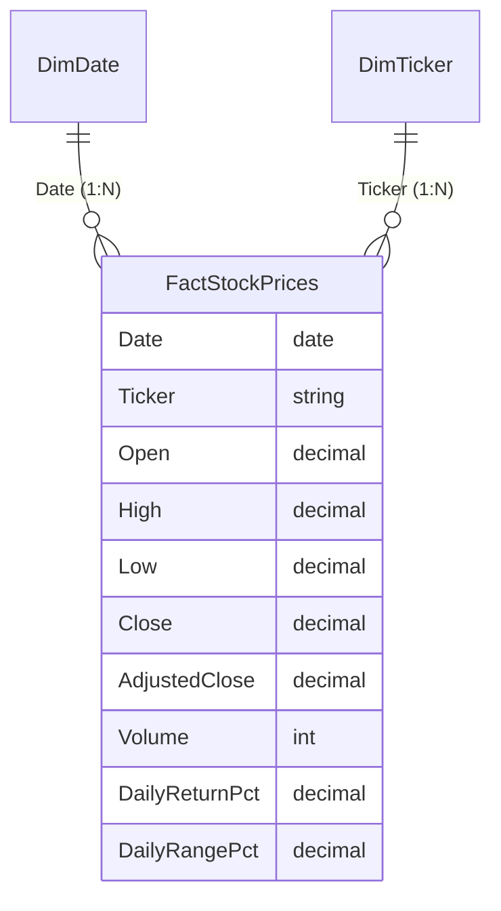

# Academic Project Report Notes
## Subject: Big Data Analysis & Visualization
### Project 2: Financial Market Analytics — Multi-Asset Volatility & Performance

---

## 1. Problem Statement & Motivation
Financial equity markets generate continuous streams of transaction telemetry. For portfolio managers, risk officers, and retail analysts, raw tabular price feeds are insufficient to interpret macro trends. Analysts require interactive Business Intelligence (BI) systems capable of:
1. Normalizing heterogeneous daily OHLCV files across diverse corporate equities.
2. Building dimensional star schemas that avoid cartesian explosion and redundant calculations.
3. Formulating robust DAX calculations that calculate returns strictly against prior trading sessions (respecting market holidays and weekend closures).
4. Providing intuitive visual perspectives on asset returns, trading volume liquidity, and annualized volatility risk.

---

## 2. Project Objectives
- Ingest and harmonize multi-ticker equity data (`AAPL`, `MSFT`, `GOOGL`, `AMZN`) for the calendar year 2023.
- Structure an optimized dimensional Star Schema linking `FactStockPrices` with `DimDate` and `DimTicker`.
- Develop DAX measures safeguarding against multi-ticker price aggregation fallacies.
- Design a 3-page interactive Power BI report with synced slicers and accessible, high-contrast dark theme visuals.
- Quantify annualized risk profiles using standard 252-trading-day square-root-of-time scaling.

---

## 3. Data Source & Preparation (Power Query ETL)
- **Data Universe:** Daily historical equity data for 4 large-cap US corporations across 2023.
- **Trading Session Count:** 250 verified market sessions (excluding 10 statutory market holidays).
- **Power Query Transformations:**
  1. Header normalization and text trimming.
  2. Strict locale assignment (`en-US`) ensuring accurate decimal and date parsing.
  3. Deduplication over `(Date, Ticker)` primary composite key.
  4. Generation of a continuous 365-day calendar dimension table (`DimDate`).

---

## 4. Star Schema Architecture

- **Relationships:** Single-direction 1-to-many filtering ensures clear filter context propagation from dimensions down to the transaction fact records.
- **Marked as Date Table:** `DimDate` designated as the primary date table to unlock optimized VertiPaq time intelligence.

---

## 5. Analytical DAX Formulas & Financial Rationale
- **Single-Ticker Price Guard:** Absolute price comparison across disparate equities is misleading because nominal share prices reflect arbitrary shares-outstanding numbers rather than corporate valuation. The `[Latest Close]` DAX measure employs `HASONEVALUE(FactStockPrices[Ticker])` to suppress ambiguous aggregations when multiple stocks are selected.
- **Non-Trading Day Integrity:** Percentage return calculations are pegged strictly to preceding trading sessions (\(t-1\)) rather than calendar dates (\(d-1\)), preventing distorted Monday calculations following closed weekends.
- **Annualized Volatility Standard:**
  \[\text{Annualized Volatility} = \text{StDev}(\text{Daily Returns}) \times \sqrt{252}\]
  Reflects standard quantitative finance practices for NYSE/NASDAQ trading frequencies.

---

## 6. Visualization Rationale & Report Pages
- **Page 1 — Market Overview:** Provides executive orientation via macro KPIs, cumulative volume distributions, and period return comparisons across assets.
- **Page 2 — Price & Return Analysis:** Enables asset-level deep dives with interactive return distribution histograms and color-coded daily return timelines.
- **Page 3 — Volume & Volatility:** Correlates trading volume surges with price volatility using bivariate scatter plots and monthly performance heatmaps.

---

## 7. Limitations & Future Scope
- **Retrospective Basis:** Analysis evaluates historical prices and does not incorporate real-time sub-second order book depth.
- **Corporate Action Adjustments:** For complex multi-year studies, dividends and stock splits require systematic total-return index adjustments.
- **Future Scope:** Integrating automated REST API ingestion (e.g., Alpha Vantage or Polygon.io) into Power BI Dataflows for scheduled cloud refreshes.
