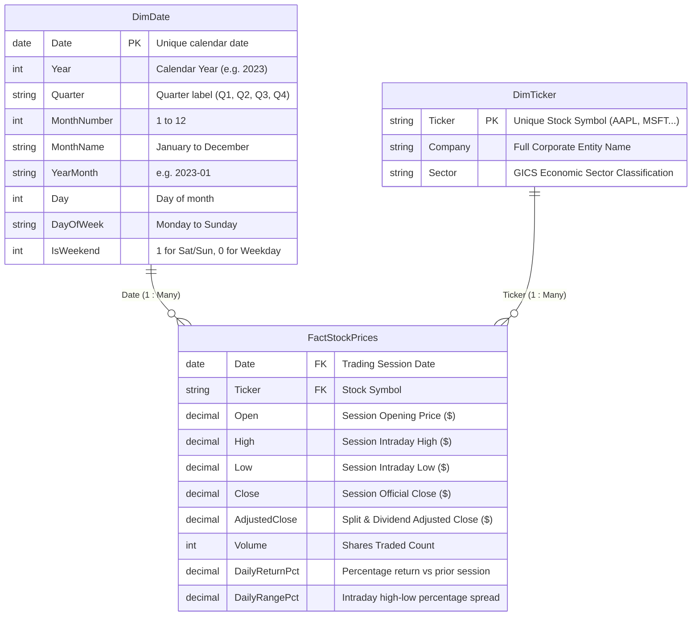

# Power BI Data Model & Relationship Architecture

This document details the relational Star Schema data model implemented for the **Financial Market Analytics Dashboard** in Power BI Desktop.

---

## 🌟 Star Schema Architecture Overview

The analytical model follows dimensional modeling best practices to ensure optimal VertiPaq columnar compression, fast DAX calculation speeds, and unambiguous filter propagation.

---

## 🔗 Table Relationships Configuration

In Power BI Desktop **Model View**, establish the following two relationships:

| From Table (Dimension) | Primary Key (PK) | To Table (Fact) | Foreign Key (FK) | Cardinality | Cross-filter direction | Make Active |
| :--- | :--- | :--- | :--- | :--- | :--- | :--- |
| `DimDate` | `Date` | `FactStockPrices` | `Date` | **1 to Many (1:\*)** | **Single** (`DimDate` filters `FactStockPrices`) | **Yes** |
| `DimTicker` | `Ticker` | `FactStockPrices` | `Ticker` | **1 to Many (1:\*)** | **Single** (`DimTicker` filters `FactStockPrices`) | **Yes** |

### Relationship Best Practices
1. **Single-Direction Filtering:** Slicers on `DimDate` and `DimTicker` seamlessly filter the fact table. Avoid bidirectional filtering to prevent ambiguous filter paths and memory overhead.
2. **Cardinality Verification:** Both dimension tables have unique, non-null primary keys.
3. **No Many-to-Many Relationships:** This star schema avoids complex cross-filtering bridges.

---

## 📅 Marking the Date Table in Power BI Desktop

To enable Power BI's native time-intelligence functions (`DATESYTD`, `SAMEPERIODLASTYEAR`, etc.):

1. In the **Fields / Data** pane, right-click `DimDate`.
2. Select **Mark as date table → Mark as date table**.
3. In the dialog, select the `Date` column.
4. Click **OK**.
5. Power BI validates that:
   - Values are unique.
   - Values are contiguous (covering 2023-01-01 through 2023-12-31 without gaps).
   - The data type is `Date`.

---

## 🗂️ Sort By Column Configurations
To prevent alphabetical sorting of calendar attributes:
- Select column `MonthName` in `DimDate` → In the ribbon, click **Column tools → Sort by column → MonthNumber**.
- Select column `DayOfWeek` in `DimDate` → Sort by a day index column if desired.

---

## 📈 Scalability Considerations
- **Row Grain:** One row per `(Date, Ticker)`. For 4 tickers across 250 trading days, `FactStockPrices` contains exactly 1,000 rows.
- **Enterprise Extensibility:** Because this model uses a star schema, adding 500 stocks or 10 years of trading history requires zero architectural changes; the columnar VertiPaq engine compresses identical dates and tickers with high compression ratios.
